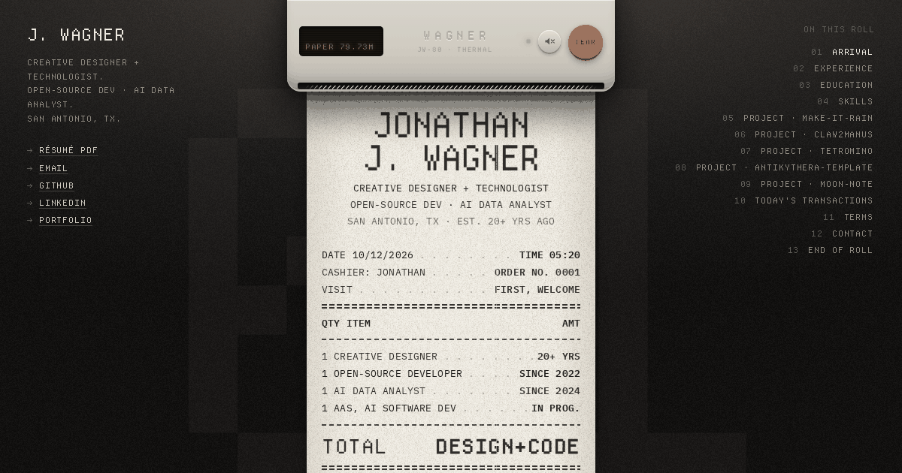

# receipt-resume

**Jonathan James Wagner's résumé, printed on a thermal receipt.**

Live: **https://frostmute.sites.tab.bot/** · Plain-text version: [`/resume.html`](https://frostmute.sites.tab.bot/resume.html) · PDF: [`resume.pdf`](resume.pdf)



## The concept

A résumé usually reads like a form. This one feels like a till receipt. You hit print, the paper feeds out line by line, and every part of a career becomes something you'd find at a register:

- **Jobs are line items.** Each role is an itemised entry with dates and what got delivered.
- **Skills are inventory.** Fresh, local, itemized: numbered SKUs filed by department.
- **Projects get QR codes.** Every open-source project is its own little receipt with a scannable code to the repo or live demo.
- **The repos are live.** Recent public GitHub activity and repo stats are fetched at load time, straight from the GitHub API.
- **Contact is a note.** You type a message, the printer prints it, and then you can send it straight to his inbox.
- **Tear here for the PDF.** The footer tears off into a downloadable PDF résumé.

Thermal paper texture, monospace type, perforations, printer sounds (with a mute toggle) and the paper's feed rhythm do the rest.

## Stack

Plain static site, with no build step, no framework and no dependencies.

- `index.html`: markup for the receipts
- `styles.css`: the paper, type, perforations and print animation
- `script.js`: printing and feed animation, live GitHub fetch, the contact note, the PDF tear-off
- `data.js`: project data (repos, descriptions, links, topics)
- `resume.html`: an accessible plain-HTML version of the résumé
- `resume.pdf`: downloadable résumé (contact details are email and links only)
- `fonts/`: IBM Plex Mono and Departure Mono (woff2, self-hosted)
- `img/`: project thumbnails, QR codes, paper grain/noise textures
- `test/site.test.mjs`: content and asset checks (Node's built-in test runner)

## Run locally

Any static file server works. From the repo root:

```sh
python3 -m http.server 8000
# then open http://localhost:8000
```

or `npx serve .`

Run the checks (Node 18+):

```sh
node --test test/site.test.mjs
```

## Deploying

The site is fully static, so it can be served from the repo root by GitHub Pages (Settings → Pages → Deploy from branch → `main` / root), Netlify, Vercel, Cloudflare Pages or anything similar.

**Notes on the current host:**

- The canonical URL and the Open Graph/Twitter image tags in `index.html` point to `https://frostmute.sites.tab.bot/`. If you move hosts, update those 4 lines so link previews follow.
- There's no backend. The contact note opens a `mailto:` link, and its body signs off "sent from frostmute.sites.tab.bot". You can change that line in `script.js` if you want.
- The live GitHub data uses unauthenticated public API calls, which allow 60 requests per hour per visitor IP. If the API can't be reached, the page falls back to the data in `data.js`.

## License

No license has been chosen yet. The résumé content and the brand are personal, so all rights are reserved for now.
